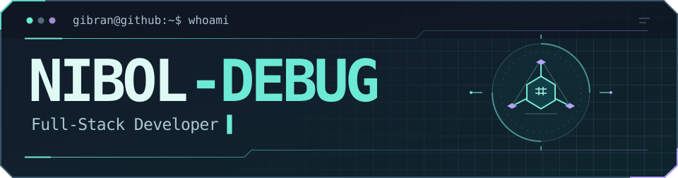
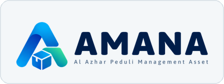

  <a href="./README.md" lang="en">English</a> · <strong>Bahasa Indonesia</strong>

  

  <picture>
    <source media="(prefers-reduced-motion: reduce)" srcset="./assets/anime-reaction-still.webp">
    
  </picture>
  &nbsp;
  <picture>
    <source media="(prefers-reduced-motion: reduce)" srcset="./assets/anime-snack-still.webp">
    
  </picture>

# Halo, saya Gibran

Saya seorang full-stack developer.

## `$ ls projects/`

### [HaloAPU](https://github.com/sarpraslazalazhar-pixel/HaloAPU)

Aplikasi helpdesk untuk mengajukan tiket, memantau statusnya, dan berkomunikasi dengan tim support lewat percakapan di tiap tiket.

`Laravel` `React` `Inertia.js` `Tailwind CSS`

### [Amana](https://github.com/sarpraslazalazhar-pixel/Amana)

Aplikasi manajemen aset LAZ Al Azhar untuk mendata inventaris, mengenali aset lewat kode QR, dan melacak mutasi serta penyusutannya.

`Laravel` `Blade` `Alpine.js` `Tailwind CSS`

## `$ cat stack.txt`

  

`PHP` `JavaScript` `Laravel` `React` `Tailwind` `Linux` `Docker` `Cisco`

## `$ git log`

  

