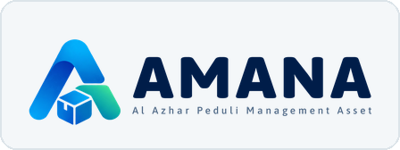

  <picture>
    <source media="(prefers-reduced-motion: reduce)" srcset="./assets/pixel-breeze-still.png">
    
  </picture>

# Halo, saya Gibran

Saya pelajar yang suka bikin antarmuka web dan ngoprek jaringan Layer 3. Di sela mengerjakan SyIAR Gemilang, saya suka bongkar-pasang Arch Linux dengan Hyprland dan push rank di *Honor of Kings*. Kalau lagi menunggu migrasi Laravel, biasanya saya putar lagu dari *Girls Band Cry*.

## Proyek pilihan

### [HaloAPU](https://github.com/sarpraslazalazhar-pixel/HaloAPU)

Aplikasi helpdesk untuk mengajukan tiket, memantau statusnya, dan berkomunikasi dengan tim support lewat percakapan di tiap tiket.

`Laravel` `React` `Inertia.js` `Tailwind CSS`

### [Amana](https://github.com/sarpraslazalazhar-pixel/Amana)

Aplikasi manajemen aset LAZ Al Azhar untuk mendata inventaris, mengenali aset lewat kode QR, dan melacak mutasi serta penyusutannya.

`Laravel` `Blade` `Alpine.js` `Tailwind CSS`

## Yang saya pakai

`PHP` `JavaScript` `Laravel` `Linux` `Cisco` `Docker`
