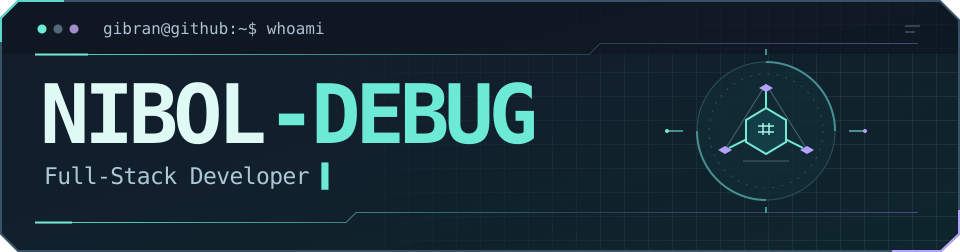

  <strong>English</strong> · <a href="./README.id.md" lang="id">Bahasa Indonesia</a>

  

  <picture>
    <source media="(prefers-reduced-motion: reduce)" srcset="./assets/anime-reaction-still.webp">
    
  </picture>
  &nbsp;
  <picture>
    <source media="(prefers-reduced-motion: reduce)" srcset="./assets/anime-snack-still.webp">
    
  </picture>

# Hi, I'm Gibran

I'm a full-stack developer.

## `$ ls projects/`

### [HaloAPU](https://github.com/sarpraslazalazhar-pixel/HaloAPU)

A help desk app for submitting support tickets, tracking their status, and talking with the support team in each ticket.

`Laravel` `React` `Inertia.js` `Tailwind CSS`

### [Amana](https://github.com/sarpraslazalazhar-pixel/Amana)

An asset management app for LAZ Al Azhar that tracks inventory, identifies assets by QR code, and records asset transfers and depreciation.

`Laravel` `Blade` `Alpine.js` `Tailwind CSS`

## `$ cat stack.txt`

  

`PHP` `JavaScript` `Laravel` `React` `Tailwind` `Linux` `Docker` `Cisco`

## `$ git log`

  

